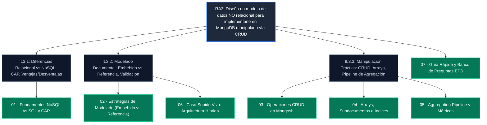

---
tags:
  - taller-bd
  - nosql
  - mongodb
  - unidad-3
  - guia-estudio
  - ep3
aliases:
  - Indice Estudio Unidad 3
  - Guia de Estudio BDY1103 Unidad 3
created: 2026-11-05
---

# Índice Maestro: Material de Estudio Unidad 3 (Bases de Datos No Relacionales y MongoDB)

**Asignatura:** Taller de Base de Datos (BDY1103)  
**Institución:** Duoc UC  
**Proyecto:** Sonido Vivo — Tienda de Instrumentos Musicales y Audio Profesional  
**Experiencia de Aprendizaje:** EA3 — Manejo de Bases de Datos No Relacionales  
**Ponderación:** 30% (Evaluación Parcial 3)  
**Objetivo del Dossier:** Dominar los principios teóricos, metodologías de diseño y técnicas prácticas de manipulación de datos en bases de datos NoSQL basadas en documentos con **MongoDB**, articulando su integración con la arquitectura relacional y PL/SQL construida en las Unidades 1 y 2.

---

## 1. Mapeo Curricular y Resultados de Aprendizaje

---

## 2. Estructura del Material de Estudio

Este conjunto de documentos desarrolla cada dimensión teórica y práctica exigida por la pauta oficial de Duoc UC:

1. [[Taller Base de Datos (PL-SQL)/Material de Estudio Unidad 3/01 - Fundamentos NoSQL vs SQL, Teorema CAP y Persistencia Políglota|01 - Fundamentos NoSQL vs SQL, Teorema CAP y Persistencia Políglota]]
   - Comparativa de paradigmas: Modelo Relacional (Tablas, Esquema Rígido, ACID) vs Modelo Documental (Colecciones, BSON flexible, BASE).
   - El Teorema CAP (Consistencia, Disponibilidad, Tolerancia a Particiones) y el Teorema PACELC.
   - Familias NoSQL: Clave-Valor (Redis), Documentales (MongoDB), Familias de Columnas (Cassandra), Grafos (Neo4j).
   - Patrón de Persistencia Políglota: Roles de Oracle (core transaccional) y MongoDB (catálogo dinámico y analítica).

2. [[Taller Base de Datos (PL-SQL)/Material de Estudio Unidad 3/02 - Estrategias de Modelado NoSQL en MongoDB (Embebido vs Referencia)|02 - Estrategias de Modelado NoSQL en MongoDB (Embebido vs Referencia)]]
   - Filosofía de diseño: *“Los datos que se leen juntos deben almacenarse juntos”*.
   - Incrustación (Embedding / Denormalización) vs Referenciación (Referencing / Normalización).
   - Tratamiento de relaciones 1:1, 1:N (Uno a Pocos vs Uno a Muchos vs Uno a Millones) y N:M.
   - Reglas de validación de esquema en MongoDB (`$jsonSchema`) para asegurar integridad de negocio sin perder flexibilidad.

3. [[Taller Base de Datos (PL-SQL)/Material de Estudio Unidad 3/03 - Operaciones CRUD y Manipulacion de Datos en Mongosh|03 - Operaciones CRUD y Manipulacion de Datos en Mongosh]]
   - Entorno `mongosh`: Comandos administrativos esenciales (`use`, `show dbs`, `show collections`).
   - Operaciones de Creación: `insertOne()`, `insertMany()`, manejo del campo inmutable `_id` (`ObjectId`).
   - Operaciones de Lectura: `find()`, `findOne()`, filtros de igualdad, operadores relacionales (`$gt`, `$gte`, `$lt`, `$lte`, `$in`, `$ne`) y lógicos (`$and`, `$or`, `$not`, `$nor`).
   - Proyecciones explícitas, ordenamiento (`sort`), límite (`limit`) y paginación (`skip`).
   - Modificación y Eliminación: `updateOne()`, `updateMany()`, `replaceOne()`, `$set`, `$inc`, `deleteOne()`, `deleteMany()`.

4. [[Taller Base de Datos (PL-SQL)/Material de Estudio Unidad 3/04 - Manipulacion Avanzada de Arrays y Subdocumentos en MongoDB|04 - Manipulacion Avanzada de Arrays y Subdocumentos en MongoDB]]
   - Manipulación atómica de arreglos: `$push`, `$addToSet`, `$pop`, `$pull`, modificadores `$each` y `$slice`.
   - Consultas sobre arreglos y subdocumentos: Operador `$elemMatch`, consulta de atributos anidados con notación de punto (`dot notation`).
   - Operadores de actualización posicionales: Operador posicional `$`, operador all-elements `$[]`, y operador filtrado `$[<identifier>]`.
   - Indexación en MongoDB: Índices simples, compuestos, multikey (en arrays) y TTL, con análisis de planes de ejecución (`explain("executionStats")`).

5. [[Taller Base de Datos (PL-SQL)/Material de Estudio Unidad 3/05 - Pipeline de Agregacion (Aggregation Framework) y Analisis de Negocio|05 - Pipeline de Agregacion (Aggregation Framework) y Analisis de Negocio]]
   - Anatomía del Aggregation Pipeline frente a `GROUP BY` y funciones analíticas de SQL.
   - Etapas clave: `$match`, `$project`, `$group`, `$sort`, `$limit`, `$unwind`, `$count`.
   - Acumuladores de agregación: `$sum`, `$avg`, `$min`, `$max`, `$push`, `$addToSet`.
   - Cruce entre colecciones con `$lookup` (simulación de Left Outer Join documental).

6. [[Taller Base de Datos (PL-SQL)/Material de Estudio Unidad 3/06 - Caso Practico Sonido Vivo - Arquitectura Hibrida Oracle PLSQL y MongoDB|06 - Caso Practico Sonido Vivo - Arquitectura Hibrida Oracle PLSQL y MongoDB]]
   - Arquitectura integral: Coexistencia entre Oracle 19c/21c (Finanzas, Ventas duras, PL/SQL) y MongoDB (Catálogo polimórfico, Especificaciones de Instrumentos, Bitácora de Auditoría y Carrito de Compras).
   - Scripts DDL con validación `$jsonSchema` para colecciones `productos`, `pedidos` y `auditoria_precios`.
   - Batería de scripts DML con casos de negocio reales listos para ejecutar en `mongosh`.

7. [[Taller Base de Datos (PL-SQL)/Material de Estudio Unidad 3/07 - Guia Rapida y Banco de Preguntas para Defensa Oral EP3|07 - Guia Rapida y Banco de Preguntas para Defensa Oral EP3]]
   - Glosario técnico de alta precisión para defensa oral y evaluación formativa/parcial.
   - Banco de preguntas críticas y respuestas modelo con fundamentación técnica y de ingeniería.
   - Matriz de verificación rápida de comandos en consola `mongosh`.

---

## 3. Enlaces Rápidos y Navegación

- [[Taller Base de Datos (PL-SQL)/Material de Estudio Unidad 2/00 - Índice Material de Estudio Unidad 2|Volver al Índice Maestro de la Unidad 2 (PL/SQL)]]
- [[Taller Base de Datos (PL-SQL)/Material AVA/Actividades/Información EA3|Ficha Oficial AVA: Experiencia de Aprendizaje 3]]
- [[Taller Base de Datos (PL-SQL)/Índice AVA - Taller de Base de Datos|Índice General de Materiales AVA]]
