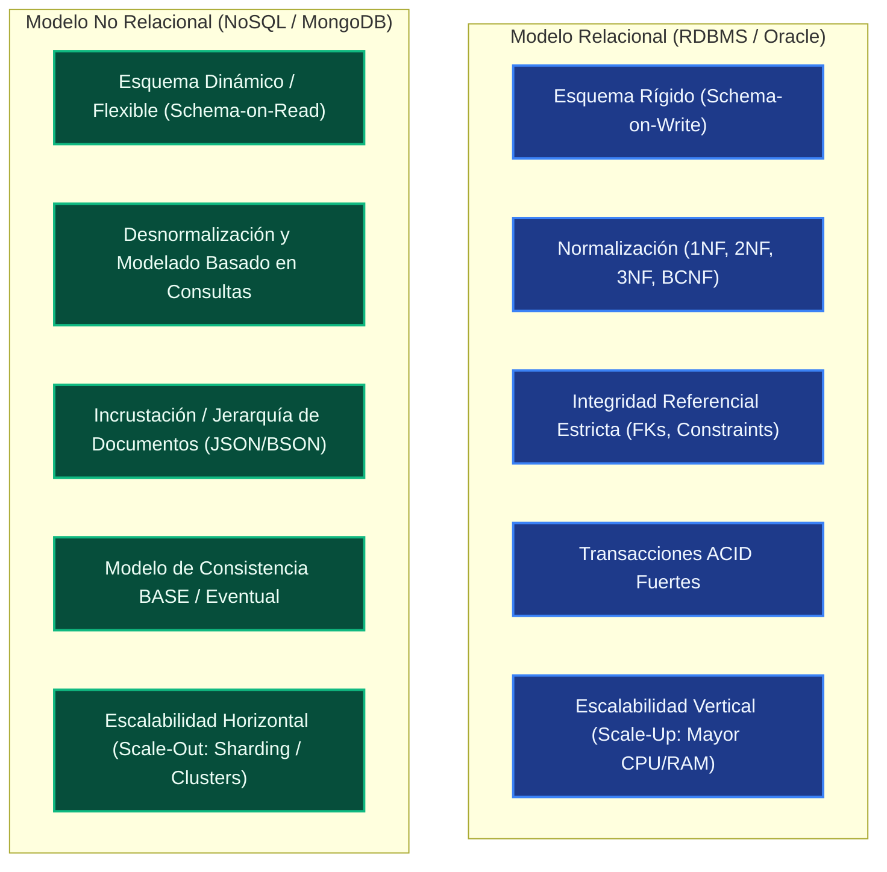
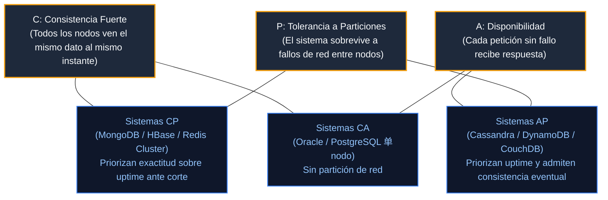
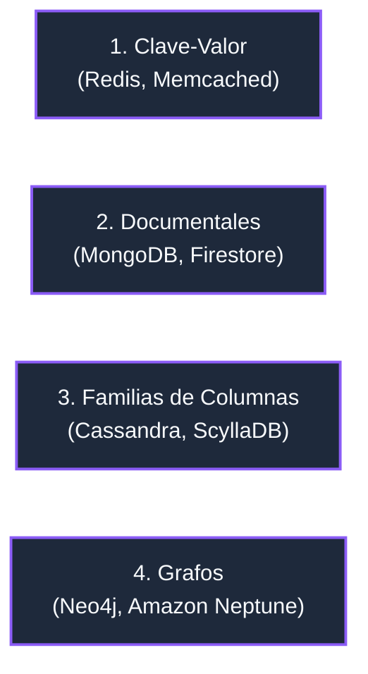
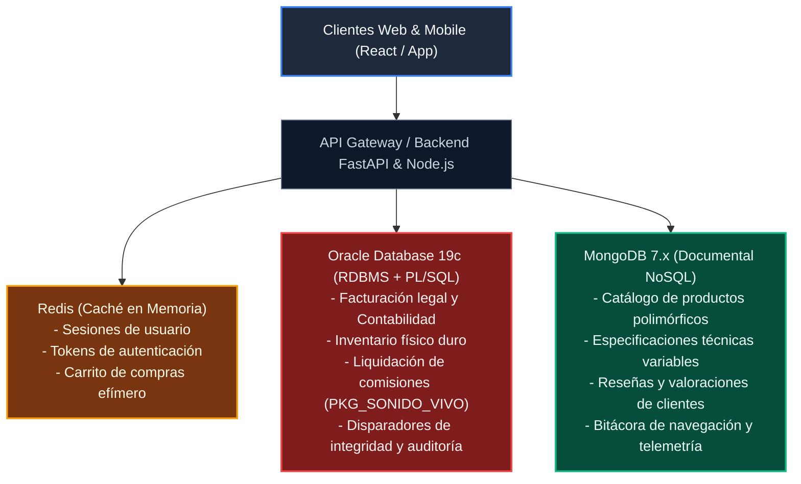

---
tags:
  - taller-bd
  - nosql
  - rdbms
  - teorema-cap
  - persistencia-poliglota
  - unidad-3
aliases:
  - Comparativa SQL vs NoSQL
  - Teorema CAP y Persistencia Poliglota
created: 2026-11-05
---

# 01 - Fundamentos NoSQL vs SQL, Teorema CAP y Persistencia Políglota

**Indicador de Logro Asociado:** **IL3.1:** Identifica las diferencias entre bases de datos relacionales y no relacionales, junto con sus ventajas y desventajas, para su aplicabilidad de acuerdo con las necesidades del negocio.

---

## 1. El Conflicto de Paradigmas: Del Modelo Relacional al Modelo NoSQL

Durante más de cuatro décadas, las bases de datos relacionales (RDBMS) basadas en el modelo formal de Edgar F. Codd dominaron la industria. Sin embargo, el surgimiento de la Web 2.0, el comercio electrónico a escala global, los dispositivos móviles y el tráfico masivo de Internet expusieron limitaciones estructurales en los sistemas estrictamente relacionales.

### Tabla Comparativa Exhaustiva

| Criterio | Bases de Datos Relacionales (SQL / Oracle) | Bases de Datos Documentales (NoSQL / MongoDB) |
| :--- | :--- | :--- |
| **Estructura básica** | Tablas bidimensionales compuestas por filas (tuplas) y columnas fijas. | Colecciones compuestas por documentos individuales (generalmente JSON/BSON). |
| **Definición de Esquema** | **Schema-on-Write:** Toda tabla exige DDL (`CREATE TABLE`) antes de insertar; cada fila comparte estrictamente las mismas columnas y tipos. | **Schema-on-Read (o Flexible):** Cada documento puede tener campos distintos, tipos polimórficos o arrays según la evolución de la aplicación. |
| **Relaciones entre datos** | Claves Foráneas (`FOREIGN KEY`) y uniones lógicas mediante sentencias `JOIN`. | Incrustación jerárquica de subdocumentos/arreglos o referencias manuales mediante IDs. |
| **Paradigma Transaccional** | **ACID** nativo y transacciones atómicas multiobjeto como estándar por defecto. | **BASE** (Consistencia Eventual). MongoDB soporta transacciones ACID multielemento desde la v4.0, pero con costo en latencia. |
| **Escalabilidad** | Predominantemente **Vertical (Scale-up):** Comprar un servidor más potente (más núcleos, más memoria RAM, discos SAN/NVMe). | Predominantemente **Horizontal (Scale-out):** Distribuir particiones de datos entre decenas o cientos de nodos económicos (*Sharding*). |
| **Lenguaje de Consulta** | SQL estándar (`SELECT`, `INSERT`, `UPDATE`, `DELETE`) enriquecido con extensiones procedurales (PL/SQL, T-SQL). | APIs orientadas a objetos y operadores específicos (`mongosh`, MQL - MongoDB Query Language) basados en sintaxis JSON/BSON. |
| **Impedancia Objeto-Relacional** | Alta: Requiere capas intermedias (ORMs como Hibernate, SQLAlchemy, Entity Framework) para mapear objetos de memoria a tablas. | Casi nula: Un documento JSON/BSON coincide de forma directa y natural con las clases y objetos del código fuente. |

---

## 2. Transacciones: ACID vs BASE

El modelo de transacciones es el pilar que determina si una base de datos prioriza la exactitud matemática inmediata o la disponibilidad y escala distribuida.

### El Modelo ACID (Garante de la Verdad Absoluta)
Las bases de datos relacionales como Oracle implementan el estándar **ACID**:
- **Atomicidad (Atomicity):** Todo o nada. Si un procedimiento en Oracle descuenta stock e inserta un detalle de venta, y ocurre un fallo a mitad de camino, se ejecuta un `ROLLBACK` total. No existen transacciones a medias.
- **Consistencia (Consistency):** La base de datos sólo pasa de un estado válido a otro estado válido. Se respetan todas las reglas de negocio, tipos de datos, restricciones `CHECK`, `NOT NULL` y claves foráneas.
- **Aislamiento (Isolation):** Las operaciones concurrentes no interfieren entre sí. Oracle implementa niveles de aislamiento (como *Read Committed* o *Serializable*) para evitar lecturas sucias (`Dirty Reads`).
- **Durabilidad (Durability):** Una vez que se emite un `COMMIT`, los cambios se graban en el registro de rehacer (`Redo Log`) y son indestructibles, resistiendo cortes eléctricos o caídas del motor.

### El Modelo BASE (Filosofía de Alta Escala en Sistemas Distribuidos)
Muchas bases de datos NoSQL adoptan el modelo **BASE**:
- **Basically Available (Básicamente Disponible):** El sistema garantiza disponibilidad operativa del servicio. Si un nodo o zona de disponibilidad colapsa, los nodos restantes siguen respondiendo peticiones, aunque se degrade temporalmente la latencia o el detalle de la respuesta.
- **Soft State (Estado Blando / Variable):** El estado del sistema puede cambiar con el tiempo sin necesidad de interacción externa directa, debido a la sincronización asíncrona de datos en segundo plano entre réplicas.
- **Eventual Consistency (Consistencia Eventual):** El sistema convergerá a un estado uniforme una vez que cesen las escrituras. Durante un intervalo (generalmente milisegundos), dos usuarios concurrentes consultando diferentes réplicas podrían ver lecturas ligeramente desfasadas.

---

## 3. El Teorema CAP y el Teorema PACELC

Formulado por Eric Brewer en la Universidad de California en Berkeley, el **Teorema CAP** establece que en cualquier sistema de datos distribuido es matemáticamente imposible garantizar simultáneamente las tres propiedades siguientes:

1. **Consistencia (Consistency):** Toda lectura recibe la escritura más reciente o un error. Ningún cliente lee datos obsoletos.
2. **Disponibilidad (Availability):** Todo nodo que no esté caído procesa y responde cualquier petición recibida, sin garantizar que sea la última versión.
3. **Tolerancia a Particiones (Partition Tolerance):** El sistema continúa operando a pesar de que la red de comunicación interna se corte, pierda paquetes o aísle un grupo de nodos del resto.

> [!IMPORTANT]
> **La regla de oro de los sistemas distribuidos:** Las redes físicas son imperfectas (cables desconectados, switches saturados, latencia interoceánica). Por lo tanto, la **Tolerancia a Particiones (P)** no es una opción negociable; es una realidad física obligatoria. Cuando ocurre una partición de red, el arquitecto de software está obligado a elegir entre:
> - **CP (Consistencia + Tolerancia a Particiones):** Se bloquean o rechazan escrituras en los nodos desbalanceados para evitar que los datos diverjan. Ejemplo: **MongoDB** (por defecto rechaza escrituras si no puede comunicarse con la mayoría del Replica Set).
> - **AP (Disponibilidad + Tolerancia a Particiones):** Se aceptan lecturas y escrituras en cualquier nodo accesible, asumiendo que los datos quedarán temporalmente desincronizados hasta que la red se recupere. Ejemplo: **Apache Cassandra**, **Amazon DynamoDB**.

### El Teorema PACELC (Extensión Práctica)
Si no hay partición de red, ¿qué ocurre? Abadi formuló **PACELC**:
- **Si hay Partición (P):** ¿Eliges Disponibilidad (**A**) o Consistencia (**C**)?
- **Else / En operación normal (E):** ¿Eliges Latencia (**L**) o Consistencia (**C**)?
MongoDB se clasifica principalmente como un sistema **PC/EC**: Ante partición elige consistencia (PC); en operación normal sincroniza réplicas priorizando consistencia sobre mínima latencia (EC), aunque configurable vía *Read Concern* y *Write Concern*.

---

## 4. Tipologías de Bases de Datos NoSQL

No todas las bases de datos NoSQL son iguales. Se dividen en cuatro familias según su estructura de datos fundamental:

### 1. Bases de Datos Clave-Valor (Key-Value)
- **Representantes:** Redis, AWS DynamoDB, Memcached.
- **Estructura:** Diccionario asociativo simple (`clave -> valor binario/string/hash`).
- **Casos de Uso:** Sesiones de usuario web, tokens JWT, carros de compra temporales, caché de alta velocidad (lecturas en microsegundos en RAM), limitadores de tasa (rate limiting).
- **Limitación:** No se puede consultar eficientemente por el contenido interno del valor sin conocer la clave.

### 2. Bases de Datos Documentales (Document Stores)
- **Representantes:** **MongoDB**, Couchbase, Google Cloud Firestore, RavenDB.
- **Estructura:** Colecciones de documentos jerárquicos estructurados en formatos auto-descriptivos como JSON, BSON o XML. Los documentos permiten anidar subdocumentos y listas de valores.
- **Casos de Uso:** Catálogos de productos con especificaciones heterogéneas (guitarras, cables, teclados), sistemas de gestión de contenido (CMS), registros de eventos/logs, backends de comercio electrónico.
- **Ventaja:** Permite indexar campos internos del documento y consultar por cualquier atributo anidado mediante MQL.

### 3. Bases de Datos de Familias de Columnas (Wide-Column Stores)
- **Representantes:** Apache Cassandra, ScyllaDB, Google Bigtable, Apache HBase.
- **Estructura:** Matrices bidimensionales dispersas donde las filas están identificadas por claves y las columnas son dinámicas, agrupadas en familias de columnas.
- **Casos de Uso:** Métricas de telemetría IoT masiva, series temporales financieras de alta frecuencia, logs de servidores a escala petabyte, mensajería de chat masivo.
- **Ventaja:** Rendimiento de escritura hiper-escalable en clústeres masivos multirregionales.

### 4. Bases de Datos de Grafos (Graph Databases)
- **Representantes:** Neo4j, Amazon Neptune, Memgraph.
- **Estructura:** Nodos (entidades), Aristas (relaciones dirigidas y tipadas) y Propiedades en ambos.
- **Casos de Uso:** Motores de recomendación social ("amigos de amigos que compraron X"), mapas de prevención de fraude bancario, enrutamiento logístico y redes de transporte.
- **Ventaja:** Navegación por relaciones complejas en tiempo constante $O(1)$ por salto (*index-free adjacency*), sin los demoledores costos de `JOIN` de un motor relacional.

---

## 5. El Enfoque Moderno: Persistencia Políglota (Polyglot Persistence)

En la ingeniería de software actual, el debate no es *"¿Es mejor SQL o NoSQL?"*, sino:
> **"¿Cuál es el motor óptimo para cada dominio de datos dentro de la arquitectura de mi organización?"**

Este principio se conoce como **Persistencia Políglota** (*Martin Fowler*). En una plataforma comercial como **Sonido Vivo**, ambos mundos cooperan armónicamente:

### Justificación Técnica de la Coexistencia:
1. **Oracle Database (Core Transaccional):**
   - Garantiza que nunca se venda mercadería inexistente mediante triggers de fila preventivos (`BEFORE INSERT` con `RAISE_APPLICATION_ERROR`).
   - Mantiene la contabilidad legal inmutable mediante paquetes PL/SQL que procesan liquidaciones masivas bajo transacciones ACID estrictas.
2. **MongoDB (Capa de Presentación y Catálogo):**
   - Una guitarra eléctrica tiene atributos como *pastillas, número de trastes, puente flotante*; un teclado tiene *teclas contrapesadas, polifonía, MIDI*; un cable de audio sólo tiene *longitud y conector*. Modelar esto en SQL exigiría decenas de tablas intermedias (patrón EAV o tablas puente con `NULLs`), mientras que en MongoDB cada instrumento es un documento BSON limpio y autónomo.
   - Proporciona lecturas a ultra-alta velocidad sin realizar ningún `JOIN` en la base de datos al renderizar la página de detalle de producto en React.
