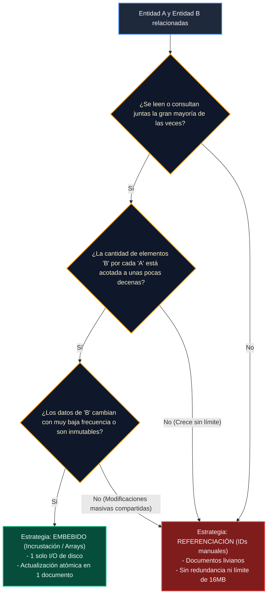

---
tags:
  - taller-bd
  - nosql
  - mongodb
  - modelado-datos
  - json-schema
  - unidad-3
aliases:
  - Estrategias de Modelado NoSQL MongoDB
  - Embebido vs Referencia MongoDB
created: 2026-11-05
---

# 02 - Estrategias de Modelado NoSQL en MongoDB (Embebido vs Referencia)

**Indicador de Logro Asociado:** **IL3.2:** Elabora un modelo de datos no relacionales para implementarlo en una base de datos NoSQL que será manipulado a través de operaciones CRUD.

---

## 1. El Formato BSON y la Anatomía de un Documento

MongoDB almacena los registros internamente bajo la especificación **BSON** (*Binary JSON*). Mientras que JSON clásico sólo soporta tipos primitivos básicos (String, Number, Boolean, Array, Object y Null), BSON extiende las capacidades para optimizar almacenamiento y velocidad de serialización en memoria:

- **`ObjectId` (12 bytes):** Identificador universal autogenerado para el campo inmutable `_id` (4 bytes timestamp de creación, 5 bytes identificador aleatorio de proceso/máquina, 3 bytes contador autoincremental).
- **`Date`:** Timestamp de 64 bits con precisión de milisegundos UTC.
- **Tipos Numéricos Explícitos:** `NumberInt` (entero de 32 bits), `NumberLong` (entero de 64 bits), `NumberDecimal` (punto flotante de 128 bits de alta precisión contable, ideal para precios y monedas).
- **Límite Estructural:** En MongoDB, un único documento BSON **no puede superar los 16 MB** de tamaño. Esta restricción de diseño previene el consumo desmedido de memoria RAM y evita saturaciones de ancho de banda.

---

## 2. La Regla de Oro del Modelado Documental

En el mundo relacional (Oracle / SQL), el diseño se basa en **la estructura de las entidades** y la normalización formal (Tercera Forma Normal - 3NF). Se normaliza para evitar duplicación, asumiendo que los `JOIN` reconstruirán los datos en tiempo de consulta.

En MongoDB y las bases de datos NoSQL, el modelado se rige por una regla diametralmente opuesta:

> **"Diseña tu esquema en función de cómo tu aplicación lee y escribe los datos, no de cómo se relacionan en el mundo abstracto. Los datos que se consultan juntos, deben guardarse juntos."**



---

## 3. Comparativa: Embebido (Embedding) vs Referenciación (Referencing)

### 3.1 Incrustación / Documentos Embebidos (Denormalización)
Consiste en anidar subdocumentos o matrices de subdocumentos directamente dentro del documento padre.

#### Caso Ejemplo: Detalle de Venta inmutable dentro de un Pedido
```javascript
// Colección: pedidos (Modelo Embebido)
{
  "_id": ObjectId("672ad501f1a23b4c5d6e7f01"),
  "codigo_pedido": "PED-2026-0091",
  "fecha": ISODate("2026-11-05T20:30:00Z"),
  "estado": "COMPLETADO",
  "cliente": {
    "rut": "18.452.123-K",
    "nombre": "Carlos Valenzuela",
    "email": "carlos.v@mail.cl"
  },
  "items": [
    {
      "producto_id": ObjectId("672ad401f1a23b4c5d6e7e10"),
      "nombre": "Fender Stratocaster American Pro II",
      "cantidad": 1,
      "precio_unitario": NumberDecimal("1450000.00"),
      "subtotal": NumberDecimal("1450000.00")
    },
    {
      "producto_id": ObjectId("672ad401f1a23b4c5d6e7e11"),
      "nombre": "Cable Fender Custom Shop 3m",
      "cantidad": 2,
      "precio_unitario": NumberDecimal("25000.00"),
      "subtotal": NumberDecimal("50000.00")
    }
  ],
  "total": NumberDecimal("1500000.00")
}
```

- **Ventajas:**
  - **Máximo Rendimiento de Lectura:** El frontend de la aplicación web solicita el pedido y en un solo I/O de disco obtiene el cliente, los productos comprados, los precios históricos y los subtotales, sin cruces ni bloqueos.
  - **Garantía Atómica:** Modificar el documento actualiza el pedido y todos sus items de forma atómica en una sola operación de escritura.
  - **Inmutabilidad Histórica:** Si el precio de catálogo de la guitarra sube mañana en Oracle, el pedido histórico retiene el precio real pagado sin alterar la contabilidad.
- **Riesgos y Desventajas:**
  - **Límite de 16 MB:** Si una colección acumula miles de elementos anidados en un solo array, el documento puede superar el límite permitido.
  - **Redundancia:** Si un dato anidado cambia con frecuencia y debe reflejarse en todos los documentos históricos, se requeriría un `updateMany` masivo.

---

### 3.2 Referenciación (Normalización)
Consiste en almacenar las entidades en colecciones separadas, vinculándolas mediante el almacenamiento del `_id` de la entidad foránea (similar a una `FOREIGN KEY` de SQL, pero sin verificación de integridad a nivel de motor).

#### Caso Ejemplo: Productos referenciando a su Fabricante
```javascript
// Colección: fabricantes
{
  "_id": ObjectId("672ad101f1a23b4c5d6e7a01"),
  "marca": "Fender Musical Instruments",
  "pais_origen": "Estados Unidos",
  "sitio_web": "https://www.fender.com"
}

// Colección: productos (Referencia al fabricante)
{
  "_id": ObjectId("672ad401f1a23b4c5d6e7e10"),
  "nombre": "Fender Stratocaster American Pro II",
  "fabricante_id": ObjectId("672ad101f1a23b4c5d6e7a01"), // REFERENCIA
  "precio": NumberDecimal("1450000.00"),
  "categoria": "Guitarras Eléctricas"
}
```

- **Ventajas:**
  - **Cero Redundancia:** La dirección o razón social de Fender se edita en un único documento.
  - **Documentos Compactos:** Se reduce drásticamente el espacio en disco y el uso de memoria caché de MongoDB (WiredTiger Engine).
- **Desventajas:**
  - Para obtener los datos de la marca junto con el producto, la aplicación debe ejecutar una segunda consulta o utilizar el operador de agregación `$lookup` (Left Outer Join), aumentando la carga de CPU y la latencia de red.

---

## 4. Las Tres Reglas de Oro para Relaciones 1:N en MongoDB

El equipo de arquitectura de MongoDB formalizó el tratamiento de cardinalidades 1 a Muchos en tres patrones canónicos:

| Tipo de Relación | Cardinalidad Estimada | Estrategia Recomendada | Implementación Técnica |
| :--- | :--- | :--- | :--- |
| **Uno a Pocos (One-to-Few)** | 1 a $\leq 10$ elementos | **Embebido directo en Array** | Anidar arreglo de subdocumentos en el documento padre (ej. Direcciones de despacho de un usuario). |
| **Uno a Muchos (One-to-Many)** | 1 a cientos o pocos miles | **Referenciación en el lado Hijo** | El documento hijo almacena el `padre_id` (ej. Cada producto guarda el `categoria_id` o `fabricante_id`). |
| **Uno a Millones (One-to-Squillions)** | 1 a decenas de miles o millones | **Referenciación estricta en el Hijo** | Jamás guardar el arreglo en el padre (crecimiento desbordado). Cada log o telemetría almacena el `dispositivo_id` (ej. Bitácoras y clics de usuario). |

---

## 5. Integridad de Datos: Validación de Esquema con `$jsonSchema`

Aunque MongoDB es flexible por naturaleza, en aplicaciones empresariales de producción como **Sonido Vivo** no se puede permitir que un desarrollador inserte un producto sin precio o un correo electrónico con formato inválido. Para ello, MongoDB provee validación nativa basada en el estándar **JSON Schema**.

### Ejemplo Práctico: Colección `productos` con Validación Estricta

```javascript
db.createCollection("productos", {
  validator: {
    $jsonSchema: {
      bsonType: "object",
      required: ["sku", "nombre", "categoria", "precio", "stock", "especificaciones"],
      properties: {
        sku: {
          bsonType: "string",
          pattern: "^[A-Z]{3}-[0-9]{4}$",
          description: "El SKU debe seguir el formato AAA-9999 (Obligatorio)"
        },
        nombre: {
          bsonType: "string",
          minLength: 3,
          maxLength: 120,
          description: "Nombre del instrumento o equipo (Obligatorio)"
        },
        categoria: {
          enum: ["Cuerdas", "Teclados", "Audio Profesional", "Percusion", "Accesorios"],
          description: "Categoría debe pertenecer a la lista oficial (Obligatorio)"
        },
        precio: {
          bsonType: "decimal",
          minimum: 0.01,
          description: "Precio debe ser un valor decimal mayor a 0 (Obligatorio)"
        },
        stock: {
          bsonType: "int",
          minimum: 0,
          description: "Stock físico disponible, entero mayor o igual a 0 (Obligatorio)"
        },
        activo: {
          bsonType: "bool",
          description: "Estado de publicación en el e-commerce"
        },
        especificaciones: {
          bsonType: "object",
          description: "Atributos técnicos dinámicos y polimórficos del instrumento"
        },
        etiquetas: {
          bsonType: "array",
          items: {
            bsonType: "string"
          },
          description: "Lista de tags de búsqueda (opcional)"
        }
      }
    }
  },
  validationLevel: "strict",      // Aplica a todas las inserciones y actualizaciones
  validationAction: "error"       // Bloquea la transacción y arroja error si no cumple
});
```

> [!TIP]
> **Modificación de validadores existentes:** Si el negocio evoluciona y se requiere agregar un nuevo campo requerido, no es necesario recrear la colección. Se utiliza el comando administrativo `collMod`:
> ```javascript
> db.runCommand({
>   collMod: "productos",
>   validator: { ...nuevoEsquema... },
>   validationLevel: "moderate" // Sólo valida documentos nuevos o modificados
> });
> ```
