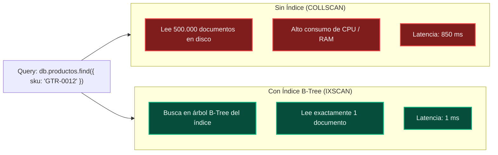

---
tags:
  - taller-bd
  - nosql
  - mongodb
  - arrays
  - subdocumentos
  - indices
  - optimizacion
  - unidad-3
aliases:
  - Manipulacion Avanzada de Arrays MongoDB
  - Subdocumentos e Indices en MongoDB
created: 2026-11-05
---

# 04 - Manipulación Avanzada de Arrays y Subdocumentos en MongoDB

**Indicador de Logro Asociado:** **IL3.2 / IL3.3:** Elabora y manipula modelos no relacionales utilizando operaciones avanzadas sobre subdocumentos y colecciones anidadas.

---

## 1. Notación de Punto (*Dot Notation*)

Para navegar por la jerarquía interna de documentos anidados y arreglos sin necesidad de descomponerlos, MongoDB utiliza la **notación de punto**:

```javascript
// Consulta sobre un atributo anidado dentro del subdocumento 'especificaciones'
db.productos.find({ "especificaciones.cuerpo": { $regex: /caoba/i } });

// Consulta sobre el primer elemento (índice 0) de un arreglo
db.productos.find({ "especificaciones.microfonos.0": "60s Burstbucker Neck" });
```

> [!IMPORTANT]
> Siempre que se acceda a un campo interno mediante notación de punto, el nombre de la clave debe encerrarse obligatoriamente entre **comillas dobles** (`"especificaciones.color"`).

---

## 2. Operadores Especializados para Consulta de Arreglos

| Operador | Propósito | Ejemplo Práctico |
| :--- | :--- | :--- |
| **`$all`** | Coincide si el arreglo contiene **todos** los elementos especificados, sin importar su orden. | `db.productos.find({ etiquetas: { $all: ["pro", "electrica"] } });` |
| **`$size`** | Coincide si el arreglo tiene exactamente la cantidad de elementos indicada. | `db.productos.find({ "especificaciones.microfonos": { $size: 2 } });` |
| **`$elemMatch`** | Exige que **múltiples condiciones se cumplan en el mismo subdocumento** del arreglo. | *Ver ejemplo detallado abajo.* |

### La Importancia Crítica de `$elemMatch`
Supongamos la colección `pedidos` con un arreglo `items`. Si ejecutamos:

```javascript
// CONSULTA INCORRECTA (Falso positivo):
// Puede coincidir si un item tiene precio > 1000000 y OTRO item distinto tiene cantidad >= 2
db.pedidos.find({
  "items.precio_unitario": { $gt: NumberDecimal("1000000") },
  "items.cantidad": { $gte: 2 }
});

// CONSULTA CORRECTA con $elemMatch:
// Garantiza que sea EL MISMO producto el que cueste más de $1.000.000 y se hayan comprado 2 o más
db.pedidos.find({
  items: {
    $elemMatch: {
      precio_unitario: { $gt: NumberDecimal("1000000") },
      cantidad: { $gte: 2 }
    }
  }
});
```

---

## 3. Modificadores Atómicos de Arreglos (Update)

Modificar un arreglo en MongoDB no requiere leer el documento a memoria, modificarlo en código y guardarlo completo. Se ejecuta a nivel de motor mediante operadores atómicos:

### 3.1 Agregar Elementos: `$push` vs `$addToSet`

```javascript
// $push: Agrega elementos al final del array (admite duplicados)
db.productos.updateOne(
  { sku: "GTR-0012" },
  { $push: { etiquetas: "oferta-black-friday" } }
);

// $push con modificadores: Insertar múltiples elementos ordenados y limitados a los últimos 5
db.productos.updateOne(
  { sku: "GTR-0012" },
  {
    $push: {
      historial_precios: {
        $each: [
          { fecha: new Date(), precio: NumberDecimal("2599990.00") }
        ],
        $sort: { fecha: -1 },
        $slice: 5 // Retiene sólo las 5 entradas más recientes en el array
      }
    }
  }
);

// $addToSet: Agrega el elemento SOLO SI NO EXISTE previamente (garantía de Set único)
db.productos.updateOne(
  { sku: "GTR-0012" },
  { $addToSet: { etiquetas: "vintage" } } // No lo duplicará si ya figuraba
);
```

### 3.2 Eliminar Elementos: `$pop` y `$pull`

```javascript
// $pop: Elimina el primer elemento (-1) o el último elemento (1) del arreglo
db.productos.updateOne(
  { sku: "GTR-0012" },
  { $pop: { etiquetas: 1 } } // Remueve la última etiqueta
);

// $pull: Remueve todos los elementos que cumplan una condición
db.pedidos.updateOne(
  { codigo_pedido: "PED-2026-0091" },
  { $pull: { items: { subtotal: { $lt: NumberDecimal("10000.00") } } } }
);
```

---

## 4. Operadores Posicionales de Actualización en Arrays

¿Cómo se actualiza un campo de un subdocumento específico que vive dentro de un arreglo?

### 4.1 Operador Posicional Clásico: `$`
Actualiza el **primer** elemento del arreglo que coincidió con el filtro del `find`:

```javascript
// Cambiar el precio unitario del item 'Fender Stratocaster' dentro del pedido
db.pedidos.updateOne(
  {
    codigo_pedido: "PED-2026-0091",
    "items.nombre": "Fender Stratocaster American Pro II"
  },
  {
    $set: {
      "items.$.precio_unitario": NumberDecimal("1420000.00"),
      "items.$.subtotal": NumberDecimal("1420000.00")
    }
  }
);
```

### 4.2 Operador Posicional Filtrado: `$[<identifier>]` con `arrayFilters`
Permite actualizar selectivamente múltiples subdocumentos dentro de un arreglo según una regla de filtrado independiente:

```javascript
// Aumentar un 10% el precio de todos los items dentro de un pedido cuyo subtotal supere $100.000
db.pedidos.updateOne(
  { codigo_pedido: "PED-2026-0091" },
  {
    $mul: { "items.$[itemCaro].subtotal": 1.10 }
  },
  {
    arrayFilters: [
      { "itemCaro.subtotal": { $gt: NumberDecimal("100000.00") } }
    ]
  }
);
```

---

## 5. Indexación y Optimización de Consultas en MongoDB

Por defecto, si una colección no posee índices sobre los campos consultados, MongoDB ejecuta un **`COLLSCAN`** (*Collection Scan*), escaneando secuencialmente cada documento guardado en disco.



### 5.1 Tipos de Índices Clave

1. **Índice Simple Único (Unique Index):**
   ```javascript
   // Garantiza unicidad del SKU a nivel de motor (equivalente a UNIQUE CONSTRAINT)
   db.productos.createIndex({ sku: 1 }, { unique: true, name: "idx_producto_sku_unique" });
   ```

2. **Índice Compuesto con Regla ESR (Equality, Sort, Range):**
   ```javascript
   // Optimiza consultas del tipo: Categoría = 'Cuerdas', ordenar por Precio DESC, Stock > 0
   db.productos.createIndex(
     { categoria: 1, precio: -1, stock: 1 },
     { name: "idx_cat_precio_stock" }
   );
   ```

3. **Índice Multikey (Sobre Arreglos):**
   ```javascript
   // Indexa cada elemento independiente del arreglo 'etiquetas'
   db.productos.createIndex({ etiquetas: 1 }, { name: "idx_etiquetas_multikey" });
   ```

### 5.2 Diagnóstico con `.explain("executionStats")`

Para comprobar técnicamente que una consulta no sufre de lentitud en producción:

```javascript
db.productos.find({ sku: "GTR-0012" }).explain("executionStats");
```

**Métricas a verificar en el reporte:**
- `"stage": "IXSCAN"` (indica que utilizó un índice).
- `"totalDocsExamined"` debe ser lo más cercano posible a `"nReturned"` (en búsquedas por clave única, ambos deben ser 1).
- Si `"stage": "COLLSCAN"`, la consulta no está indexada y degradará el sistema bajo alta concurrencia.
