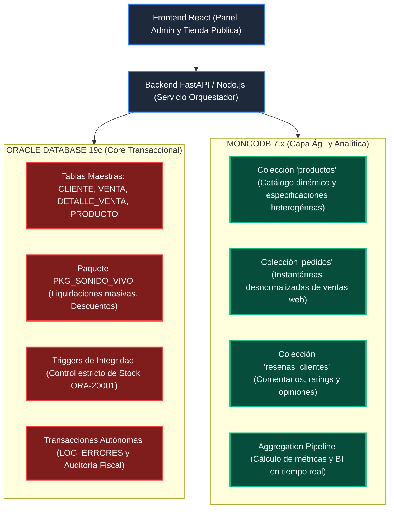

---
tags:
  - taller-bd
  - nosql
  - mongodb
  - caso-practico
  - sonido-vivo
  - arquitectura-hibrida
  - unidad-3
aliases:
  - Caso Practico Sonido Vivo MongoDB
  - Script Completo MongoDB Sonido Vivo
created: 2026-11-05
---

# 06 - Caso Práctico Sonido Vivo - Arquitectura Híbrida Oracle PL/SQL y MongoDB

**Indicador de Logro Asociado:** **IL3.2 / IL3.3:** Elabora un modelo de datos no relacional e implementa la solución completa en MongoDB manipulada mediante operaciones CRUD y agregaciones, integrada con el ecosistema de la asignatura.

---

## 1. Arquitectura de Coexistencia: ¿Quién hace qué?

En la solución corporativa de **Sonido Vivo**, evitamos forzar un solo motor para resolver problemas incompatibles:



---

## 2. Script DDL de Inicialización y Validadores en MongoDB Shell (`mongosh`)

Copia y ejecuta este bloque completo en tu terminal `mongosh` para inicializar la base de datos `sonido_vivo` con sus colecciones y validadores `$jsonSchema`:

```javascript
// =============================================================================
// SCRIPT DE INICIALIZACION: SONIDO VIVO - BASE DE DATOS NOSQL MONGODB
// Asignatura: Taller de Base de Datos (BDY1103) - Duoc UC
// =============================================================================

use sonido_vivo;

// 1. Limpieza preventiva de colecciones anteriores
db.productos.drop();
db.pedidos.drop();
db.resenas_clientes.drop();

// 2. Creación de Colección 'productos' con Esquema Estricto
db.createCollection("productos", {
  validator: {
    $jsonSchema: {
      bsonType: "object",
      required: ["sku", "nombre", "categoria", "precio", "stock", "especificaciones"],
      properties: {
        sku: {
          bsonType: "string",
          pattern: "^[A-Z]{3}-[0-9]{4}$",
          description: "SKU formato AAA-9999 (Obligatorio)"
        },
        nombre: {
          bsonType: "string",
          minLength: 3,
          description: "Nombre descriptivo del instrumento (Obligatorio)"
        },
        categoria: {
          enum: ["Cuerdas", "Teclados", "Audio Profesional", "Percusion", "Accesorios"],
          description: "Categoría de instrumento válida (Obligatorio)"
        },
        precio: {
          bsonType: "decimal",
          minimum: 1.00,
          description: "Precio de venta en CLP mayor a cero (Obligatorio)"
        },
        stock: {
          bsonType: "int",
          minimum: 0,
          description: "Stock disponible no negativo (Obligatorio)"
        },
        activo: {
          bsonType: "bool",
          description: "Estado de disponibilidad en catálogo"
        },
        especificaciones: {
          bsonType: "object",
          description: "Atributos dinámicos del producto (Obligatorio)"
        },
        etiquetas: {
          bsonType: "array",
          items: { bsonType: "string" },
          description: "Etiquetas de categorización y búsqueda"
        }
      }
    }
  }
});

// 3. Creación de Colección 'pedidos' (Modelo Embebido para Checkout)
db.createCollection("pedidos", {
  validator: {
    $jsonSchema: {
      bsonType: "object",
      required: ["codigo_pedido", "fecha", "estado", "cliente", "items", "total"],
      properties: {
        codigo_pedido: { bsonType: "string" },
        fecha: { bsonType: "date" },
        estado: {
          enum: ["PENDIENTE", "PAGADO", "COMPLETADO", "CANCELADO"]
        },
        cliente: {
          bsonType: "object",
          required: ["rut", "nombre", "email"],
          properties: {
            rut: { bsonType: "string" },
            nombre: { bsonType: "string" },
            email: { bsonType: "string" }
          }
        },
        items: {
          bsonType: "array",
          minItems: 1,
          items: {
            bsonType: "object",
            required: ["sku", "nombre", "cantidad", "precio_unitario", "subtotal"],
            properties: {
              sku: { bsonType: "string" },
              nombre: { bsonType: "string" },
              cantidad: { bsonType: "int", minimum: 1 },
              precio_unitario: { bsonType: "decimal" },
              subtotal: { bsonType: "decimal" }
            }
          }
        },
        total: { bsonType: "decimal", minimum: 0 }
      }
    }
  }
});

// 4. Creación de Índices Estratégicos
db.productos.createIndex({ sku: 1 }, { unique: true, name: "idx_producto_sku" });
db.productos.createIndex({ categoria: 1, precio: -1 }, { name: "idx_cat_precio" });
db.productos.createIndex({ etiquetas: 1 }, { name: "idx_etiquetas_multi" });
db.pedidos.createIndex({ codigo_pedido: 1 }, { unique: true, name: "idx_pedido_codigo" });
db.pedidos.createIndex({ "cliente.rut": 1 }, { name: "idx_pedidos_cliente_rut" });
```

---

## 3. Script DML: Carga de Datos Iniciales

```javascript
// =============================================================================
// CARGA DE DATOS: PRODUCTOS HETEROGÉNEOS
// =============================================================================

db.productos.insertMany([
  {
    sku: "GTR-0101",
    nombre: "Fender Stratocaster American Professional II",
    categoria: "Cuerdas",
    precio: NumberDecimal("1890000.00"),
    stock: NumberInt(5),
    activo: true,
    especificaciones: {
      tipo: "Electrica",
      cuerpo: "Aliso selecto",
      diapason: "Arce",
      trastes: 22,
      configuracion_pastillas: "SSS V-Mod II",
      puente: "Tremolo sincronizado 2 puntos",
      color: "Miami Blue"
    },
    etiquetas: ["fender", "stratocaster", "usa", "pro"]
  },
  {
    sku: "GTR-0102",
    nombre: "Gibson Les Paul Standard 50s",
    categoria: "Cuerdas",
    precio: NumberDecimal("2590000.00"),
    stock: NumberInt(3),
    activo: true,
    especificaciones: {
      tipo: "Electrica",
      cuerpo: "Caoba maciza con tapa de arce",
      diapason: "Palisandro indio",
      trastes: 22,
      configuracion_pastillas: "HH Burstbucker 1 y 2",
      color: "Tobacco Burst",
      peso_kg: 4.1
    },
    etiquetas: ["gibson", "lespaul", "vintage", "humbucker"]
  },
  {
    sku: "TEC-0201",
    nombre: "Nord Stage 4 Compact 73 Teclas",
    categoria: "Teclados",
    precio: NumberDecimal("4290000.00"),
    stock: NumberInt(2),
    activo: true,
    especificaciones: {
      tipo: "Sintetizador de Escenario",
      teclas: "73 teclas semi-contrapesadas Waterfall",
      memoria_piano_mb: 2048,
      motores_sintesis: ["Waveform", "FM", "Sample Synth"],
      drawbars_fisicos: true,
      peso_kg: 10.4
    },
    etiquetas: ["nord", "teclado", "sintetizador", "escenario"]
  },
  {
    sku: "AUD-0301",
    nombre: "Microfono Shure SM7B",
    categoria: "Audio Profesional",
    precio: NumberDecimal("429990.00"),
    stock: NumberInt(15),
    activo: true,
    especificaciones: {
      tipo: "Dinamico",
      patron_polar: "Cardioide",
      respuesta_frecuencia: "50Hz - 20kHz",
      impedancia_salida_ohm: 150,
      blindaje_electromagnetico: true
    },
    etiquetas: ["shure", "estudio", "broadcasting", "podcast"]
  },
  {
    sku: "AUD-0302",
    nombre: "Interfaz Universal Audio Apollo Twin X Duo",
    categoria: "Audio Profesional",
    precio: NumberDecimal("1150000.00"),
    stock: NumberInt(6),
    activo: true,
    especificaciones: {
      tipo: "Interfaz Thunderbolt 3",
      canales_e_s: "10 x 6",
      procesamiento_dsp: "DUO Core Realtime UAD",
      resolucion_khz: 192,
      preamplificadores: 2
    },
    etiquetas: ["uad", "interfaz", "thunderbolt", "estudio"]
  }
]);

// =============================================================================
// CARGA DE DATOS: PEDIDOS REALIZADOS (HISTÓRICOS)
// =============================================================================

db.pedidos.insertMany([
  {
    codigo_pedido: "PED-2026-1001",
    fecha: new Date("2026-10-15T14:20:00Z"),
    estado: "COMPLETADO",
    cliente: {
      rut: "15.789.456-3",
      nombre: "Rodrigo Morales",
      email: "r.morales@estudio.cl"
    },
    items: [
      {
        sku: "AUD-0301",
        nombre: "Microfono Shure SM7B",
        cantidad: NumberInt(2),
        precio_unitario: NumberDecimal("429990.00"),
        subtotal: NumberDecimal("859980.00")
      },
      {
        sku: "AUD-0302",
        nombre: "Interfaz Universal Audio Apollo Twin X Duo",
        cantidad: NumberInt(1),
        precio_unitario: NumberDecimal("1150000.00"),
        subtotal: NumberDecimal("1150000.00")
      }
    ],
    total: NumberDecimal("2009980.00")
  },
  {
    codigo_pedido: "PED-2026-1002",
    fecha: new Date("2026-10-20T18:45:00Z"),
    estado: "COMPLETADO",
    cliente: {
      rut: "18.334.992-1",
      nombre: "Camila Fernandez",
      email: "camila.guitar@live.com"
    },
    items: [
      {
        sku: "GTR-0101",
        nombre: "Fender Stratocaster American Professional II",
        cantidad: NumberInt(1),
        precio_unitario: NumberDecimal("1890000.00"),
        subtotal: NumberDecimal("1890000.00")
      }
    ],
    total: NumberDecimal("1890000.00")
  }
]);
```

---

## 4. Batería de Consultas de Negocio para Demostración

### Consulta 1: Buscar instrumentos con pastillas 'Humbucker' o con peso inferior a 5 kg
```javascript
db.productos.find({
  $or: [
    { "especificaciones.configuracion_pastillas": { $regex: /humbucker/i } },
    { "especificaciones.peso_kg": { $lt: 5.0 } }
  ]
}, { sku: 1, nombre: 1, precio: 1, especificaciones: 1, _id: 0 });
```

### Consulta 2: Descontar stock de forma atómica tras una orden de compra
```javascript
db.productos.updateOne(
  { sku: "AUD-0301", stock: { $gte: 2 } },
  { $inc: { stock: -2 } }
);
```

### Consulta 3: Pipeline para Dashboard de Ingresos Consolidados
```javascript
db.pedidos.aggregate([
  { $match: { estado: "COMPLETADO" } },
  { $unwind: "$items" },
  {
    $group: {
      _id: "$items.sku",
      nombre_producto: { $first: "$items.nombre" },
      unidades_facturadas: { $sum: "$items.cantidad" },
      monto_acumulado: { $sum: "$items.subtotal" }
    }
  },
  { $sort: { monto_acumulado: -1 } }
]);
```
